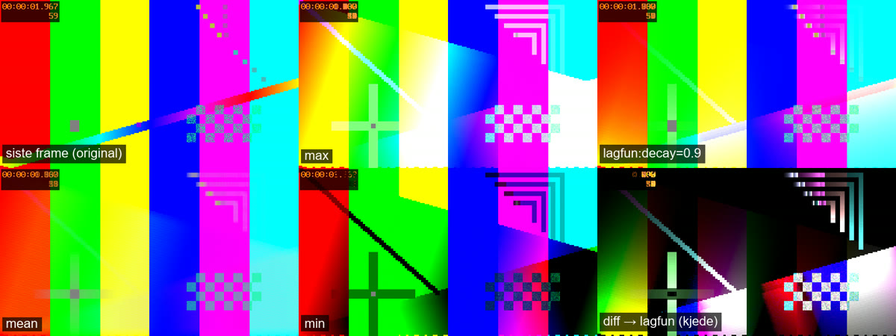

# shader-lab

Et øvingsprosjekt for å lære å skrive GPU-shadere, med video som råstoff.

Du skriver et lite **HLSL compute-filter** i én fil. shader-lab dekoder en video på grafikkortet, kjører filteret
ditt på hver eneste frame, og gir deg resultatet som ett bilde (og eventuelt en video). Filteret kan huske ting
mellom frames, og det er der det blir interessant: lysspor, gjennomsnitt som fjerner støy, bevegelse som lyser opp,
haler som falmer.


*Samme testklipp gjennom seks filtre. Øverst: originalen, `max` (lyseste verdi over hele klippet) og `lagfun`
(spor som falmer). Nederst: `mean` (snitt), `min` (mørkeste verdi) og en kjede `diff → lagfun` (bare bevegelse,
med hale).*

**Hvorfor dette er en god måte å lære shadere på:**

- **Ett filter = én fil.** Ingen C#, ingen grafikk-API, ingen vinduer. Kjernen tar seg av video, GPU-ressurser og
  fargerom; du skriver bare det som skjer med én piksel.
- **Svar på under et sekund.** Med `--watch` kompileres og kjøres filteret på nytt hver gang du lagrer.
- **Feilmeldinger som peker på din linje**, med kildelinjen og en `^` under feilen.
- **Tid er gratis.** Fordi filteret ser hundrevis av frames, lærer du det de fleste shader-introer hopper over:
  tilstand (state), akkumulering, presisjon og hva som skjer over tid.

Kun Windows (Direct3D 11). Teknisk spesifikasjon: [`docs/shader-lab-spec.md`](docs/shader-lab-spec.md).

---

## Innhold

1. [Kom i gang](#1-kom-i-gang)
2. [Slik fungerer det](#2-slik-fungerer-det)
3. [Arbeidsflyten](#3-arbeidsflyten)
4. [Lær shadere: fra null til ditt første filter](#4-lær-shadere-fra-null-til-ditt-første-filter)
5. [Filterkontrakten (oppslag)](#5-filterkontrakten-oppslag)
6. [HLSL-jukselapp](#6-hlsl-jukselapp)
7. [Vanlige feil og hvordan du finner dem](#7-vanlige-feil-og-hvordan-du-finner-dem)
8. [Læringssti: eksempler og øvelser](#8-læringssti-eksempler-og-øvelser)
9. [Kjeding, video og forhåndsvisning](#9-kjeding-video-og-forhåndsvisning)
10. [Testing](#10-testing)
11. [Kommandooversikt](#11-kommandooversikt)
12. [Prosjektstruktur](#12-prosjektstruktur)
13. [Å jobbe sammen med en AI](#13-å-jobbe-sammen-med-en-ai)
14. [Begrensninger og lisens](#14-begrensninger-og-lisens)

---

## 1. Kom i gang

### Du trenger

| | Hvorfor |
|---|---|
| Windows 10/11 | Direct3D 11 og maskinvare-videodekoding (D3D11VA) |
| Et grafikkort som kan dekode H.264/HEVC | Nesten alle fra de siste ti årene. Testet på NVIDIA |
| [.NET 9 SDK](https://dotnet.microsoft.com/download/dotnet/9.0) | Bygger og kjører programmet |
| `ffmpeg` på PATH (valgfritt) | Bare for å lage testklipp (`make-clips.ps1`) og for `--video-out`. [gyan.dev](https://www.gyan.dev/ffmpeg/builds/) sin «full»-build har det som trengs |

### Første gang

Åpne PowerShell i repo-mappen:

```powershell
powershell -File get-ffmpeg.ps1      # henter FFmpeg 7.1-bibliotekene til ffmpeg/ (én gang)
dotnet build
Set-Alias shaderlab (Resolve-Path .\bin\Debug\net9.0\shaderlab.exe)
shaderlab tests\clips\dot.mp4 -o ut.png -f max
```

Du skal få noe slikt:

```
GPU 0: <grafikkortet ditt>
Lerret: 256x144, stride=1, FrameCount=120
Kjede: max
  dot.mp4: 256x144 h264, 120 frames
120 frames på 0.14 s (870 fps) -> ut.png
```

`ut.png` viser en hvit strek: `dot.mp4` er en prikk som beveger seg over grå bakgrunn, og `max` husker det
lyseste hver piksel har vært.

> **Om aliaset:** `Set-Alias` gjelder bare i det PowerShell-vinduet. Resten av denne README-en bruker `shaderlab`.
> Alternativet er `dotnet run -- <argumenter>`, som også bygger, men er litt tregere å starte. Filtre trenger
> aldri ny build; bare endringer i C#-koden gjør det. Programmet finner `filters/` og `shaders/` selv, også om du
> står i en annen mappe.

Se hvilke filtre som finnes:

```powershell
shaderlab --list-filters
```

Flere testklipp (svart, og et fargeklipp i 10-bit HEVC) lager du med `powershell -File tests\make-clips.ps1`.
Bare `dot.mp4` ligger i repoet.

---

## 2. Slik fungerer det

```
 video.mp4 ──ffmpeg/D3D11VA──► dekodet frame i VRAM (NV12 / P010)
                                   │
                                   ▼
                [kjerne] decode.hlsl: YUV → lineær RGB (RGBA32F)        ← fast, du rører den ikke
                                   │
                                   ▼
                filters/<ditt>.hlsl  Accumulate()                        ← det du skriver
                   leser:   Input, StateIn0, FrameInfo, Params
                   skriver: StateOut0 (husk til neste frame), Output (bildet)
                                   │   … én gang per frame, gjennom hele klippet
                                   ▼
                [kjerne] (valgfri) Finalize() én gang til slutt
                                   │
                                   ▼
                [kjerne] encode.hlsl: lineær → sRGB, 8 bit   →   ut.png
```

Tre ting er verdt å merke seg:

- **Framene forlater aldri GPU-en.** Dekoderen skriver rett i videominnet, filteret leser derfra, og bare det
  ferdige bildet kopieres tilbake. Derfor går det fort: flaskehalsen er videodekoderen, ikke shaderen din.
- **Filteret ditt ser bare lineær RGB i 32-bit flyttall.** YUV, gamma, 8/10 bit og videoformater er håndtert
  før og etter. Verdier over 1.0 er lov underveis; de klippes først når bildet skrives.
- **Én shader-«tråd» per piksel.** Funksjonen `Accumulate` kjøres for hver piksel, parallelt, for hver frame.
  Mer om det i del 4.

---

## 3. Arbeidsflyten

Slik ser en øvingsøkt ut:

1. Start hot reload i et PowerShell-vindu:
   ```powershell
   shaderlab tests\clips\dot.mp4 -o ut.png -f lagfun --watch --max-frames 120
   ```
2. Åpne `ut.png` i en bildeviser som laster filen på nytt automatisk (VS Code, IrfanView, nomacs, …).
3. Åpne `filters\lagfun.hlsl` i editoren, endre noe, og lagre.
4. Innen et sekund står det `120 frames på 0.1 s -> ut.png` i terminalen, og bildet er oppdatert.
5. Har du en feil, ser du den med en gang, og det forrige bildet blir stående:
   ```
   filters/lagfun.hlsl(15,52): error X3004: undeclared identifier 'decya'
           float4 v = max(Input[id.xy], StateIn0[id.xy] * decya);
                                                          ^^^^^
   Ikke kjørt; ut.png er urørt.
   ```
6. `Ctrl+C` avslutter.

Nyttige ting underveis:

| Kommando | Når |
|---|---|
| `-f lagfun:decay=0.8` | Prøv en annen parameterverdi uten å endre filen |
| `--max-frames 60` | Kortere kjøring. `FrameCount` i shaderen blir 60 |
| `--exposure -2` / `--normalize` | Bildet er for lyst/mørkt. `--normalize` gjør den lyseste verdien hvit |
| `shaderlab --dump-shader lagfun` | Se nøyaktig hva som ble kompilert (kjernens preamble + filen din), med linjenumre |
| `tests\clips\color.mp4` | Når du vil se farger og bevegelse, ikke bare en prikk |
| Egne videoer | Lyn, trafikk om natten, stjerner, vann: det er der filtrene blir morsomme |

---

## 4. Lær shadere: fra null til ditt første filter

### 4.1 Den mentale modellen

En vanlig løkke på CPU ville sett slik ut:

```csharp
for (int y = 0; y < height; y++)
    for (int x = 0; x < width; x++)
        output[x, y] = input[x, y] * 2;
```

En **compute shader** er *innholdet* i løkken, og GPU-en kjører det for alle pikslene samtidig, i tusenvis av
parallelle tråder:

```hlsl
[numthreads(8, 8, 1)]
void Accumulate(uint3 id : SV_DispatchThreadID)
{
    if (any(id.xy >= Size)) return;
    Output[id.xy] = Input[id.xy] * 2;
}
```

- `id.xy` er pikselen denne tråden har ansvar for (x, y). Du skriver koden for **én** piksel.
- `[numthreads(8, 8, 1)]` betyr at trådene startes i grupper på 8×8. Kjernen starter nok grupper til å dekke
  bildet, og derfor blir det ofte noen tråder for mye i kantene.
- `if (any(id.xy >= Size)) return;` sender de overflødige trådene hjem. Glem den, og trådene i kanten jobber med
  piksler som ikke finnes. (D3D11 ignorerer skriving utenfor teksturen og gir 0 ved lesing, så feilen viser seg
  gjerne først som rare kanter når du begynner å lese nabopiksler.)
- Trådene kan ikke snakke sammen eller vite hva de andre gjør (med unntak av avansert `groupshared`, se øvelse 10).
  Hver piksel må kunne regnes ut alene.

### 4.2 Ditt første filter: lysere bilde

Lag `filters\brighten.hlsl`:

```hlsl
//! name: brighten
//! description: Gjør siste frame lysere
//! state: 0
//! param: gain float 2 min=0 max=10

[numthreads(8, 8, 1)]
void Accumulate(uint3 id : SV_DispatchThreadID)
{
    if (any(id.xy >= Size)) return;   // tråder utenfor bildet gjør ingenting

    float3 rgb = Input[id.xy].rgb;    // lineær RGB for denne pikselen
    Output[id.xy] = float4(rgb * gain, 1);
}
```

Kjør det:

```powershell
shaderlab tests\clips\color.mp4 -o ut.png -f brighten --watch
```

Det du nettopp brukte:

- **`//!`-linjene** er headeren. `name` er navnet du bruker med `-f`. `state: 0` sier at filteret ikke trenger å
  huske noe. `param` lager en variabel `gain` som du kan bruke direkte i koden, og overstyre med
  `-f brighten:gain=4`.
- **`Input`** er framen, i lineær RGB. **`Output`** er det som blir bildet.
- Uten state er resultatet bare siste frame, behandlet. Det er nyttig for å lære syntaks, men det er state som gjør
  dette prosjektet interessant.

Prøv: bytt `rgb * gain` med `1 - rgb`, med `rgb.bgr` eller med `rgb * float3(1, 0.5, 0.2)`, og se hva som skjer.

### 4.3 Tid: å huske mellom frames

Et filter som husker den lyseste verdien hver piksel har hatt:

```hlsl
//! name: brightest
//! description: Lyseste verdi så langt (min egen max)

[numthreads(8, 8, 1)]
void Accumulate(uint3 id : SV_DispatchThreadID)
{
    if (any(id.xy >= Size)) return;

    float4 previous = StateIn0[id.xy];          // det vi husket fra forrige frame
    float4 current  = Input[id.xy];             // denne framen
    float4 result   = max(previous, current);

    StateOut0[id.xy] = result;                  // husk til neste frame
    Output[id.xy]    = result;                  // det som blir bildet
}
```

Dette er grunnmønsteret for nesten alle filtrene: **les forrige state, regn, skriv ny state, skriv output.**

- `StateIn0` er det `StateOut0` var forrige frame. Kjernen bytter dem etter hver frame («ping-pong»).
  To separate teksturer er nødvendig fordi tusenvis av tråder leser og skriver samtidig; å lese og skrive samme
  tekstur ville gitt kaos så fort du ser på nabopiksler.
- Hva er `StateIn0` før første frame? Det bestemmer `//! init:`. Standard er `0`. For `min` ville det gitt et
  svart bilde (min av 0 og alt annet er 0), og derfor bruker `filters\min.hlsl` `//! init: +inf`.
  `//! init: first` starter på første frame, som `ema` trenger.
- State er ikke bare «bildet så langt». Det kan være en sum, en teller i `.a`, forrige frame (`diff`), eller
  to ting samtidig med `//! state: 2` (`StateIn1`/`StateOut1`).

### 4.4 Lineært lys: hvorfor tallene er som de er

Pikselverdier i en video (og i PNG) er *gamma-kodet*: 0.5 betyr ikke halvparten så mye lys som 1.0, men omtrent
en femtedel. Det er praktisk for lagring, men feil for regning. shader-lab gjør derfor om alt til **lineært lys**
før filteret ditt ser det, og tilbake når bildet skrives.

Konsekvenser du vil merke:

- Snitt, sum og blending blir fysisk riktige: `mean` ser ut som én lang eksponering, ikke som et grått søl.
- Grått i testklippet er **0.216**, ikke 0.5. Middelsgrått på skjermen er rundt 0.2 i lineært lys.
- Noen operasjoner er laget for øyet og hører hjemme i gamma-rommet. `filters\invert.hlsl` gjør om til sRGB,
  inverterer og gjør om tilbake: prøv å fjerne konverteringen og se hvor feil det blir.
- `SrgbToLinear`, `LinearToSrgb` og `Luma` ligger i `shaders\core\common.hlsli` og er alltid tilgjengelige.

### 4.5 Se verdier du ikke kan printe

En shader kan ikke skrive til konsollen. Vil du vite hva en verdi er, så **mal den**:

```hlsl
//! name: showtime
//! state: 0

[numthreads(8, 8, 1)]
void Accumulate(uint3 id : SV_DispatchThreadID)
{
    if (any(id.xy >= Size)) return;
    float progress = FrameIndex / (float)max(FrameCount, 1);   // 0 → 1 gjennom klippet
    Output[id.xy] = float4(progress, Time / 4.0, 0, 1);         // rødt = fremdrift, grønt = tid
}
```

Kjør med `--max-frames` på forskjellige verdier og se fargen endre seg. Teknikken virker for alt: en vekt, en
terskel, om en betingelse er sann (`Output[id.xy] = cond ? float4(1, 0, 0, 1) : Input[id.xy];`).

---

## 5. Filterkontrakten (oppslag)

### Header

```hlsl
//! name: mitt-filter                      // påkrevd; brukes med -f
//! description: Kort forklaring           // vises i --list-filters
//! state: 1                               // 0, 1 (standard) eller 2 state-teksturer
//! init: 0                                // 0 (standard) | first | +inf | -inf
//! param: styrke float 0.5 min=0 max=1    // 0 eller flere
```

- Headeren er `//!`-linjene i kommentarblokken øverst i filen. Vanlige `//`-kommentarer kan stå mellom.
- Parametertyper: `float`, `float2`, `float3`, `float4`, `int`, `uint`. Vektorer skrives med komma:
  `//! param: farge float3 1,0.5,0` og `-f mitt-filter:farge=0,1,0`.
- `min`/`max` er valgfrie og sjekkes når du gir verdier med `-f`.

### Det kjernen gir deg (ikke deklarer dette selv)

| Navn | Type | Innhold |
|---|---|---|
| `Input` | `Texture2D<float4>` | Nåværende frame, lineær RGB. I en kjede: forrige stegs `Output` |
| `Frame` | `Texture2D<float4>` | Alltid den originale framen, uansett plass i kjeden |
| `StateIn0`, `StateIn1` | `Texture2D<float4>` | State fra forrige frame |
| `StateOut0`, `StateOut1` | `RWTexture2D<float4>` | Ny state |
| `Output` | `RWTexture2D<float4>` | Det som blir bildet |
| `FrameIndex` | `uint` | 0, 1, 2, … (etter `--stride`). I `Finalize`: antall frames |
| `FrameCount` | `uint` | Totalt antall frames hvis kjent, ellers 0 |
| `Size` | `uint2` | Bildets bredde og høyde |
| `Time` | `float` | Sekunder fra starten av gjeldende fil |
| `Dt` | `float` | Sekunder siden forrige frame (0 for første frame i hver fil) |
| `FileIndex` | `uint` | Hvilken inputfil (ved flere) |
| dine `param`-er | som deklarert | Fra headeren, overstyrt av `-f navn:p=v` |
| `SrgbToLinear`, `LinearToSrgb`, `Luma` | funksjoner | Fra `common.hlsli` |

### Det du leverer

- **`Accumulate`** (påkrevd): kjøres én gang per frame. Les `Input` og `StateIn*`, skriv `StateOut*` og `Output`.
- **`Finalize`** (valgfri): kjøres én gang etter siste frame, for eksempel for å dele en sum på antall frames.
  Den oppdages automatisk. Se `filters\mean.hlsl`.

Begge må ha `[numthreads(8, 8, 1)]` og `uint3 id : SV_DispatchThreadID`, og bør starte med grensesjekken.

---

## 6. HLSL-jukselapp

| Det du vil | HLSL |
|---|---|
| Vektorer | `float`, `float2`, `float3`, `float4`; `uint2` osv. |
| Plukke ut komponenter («swizzle») | `c.rgb`, `c.r`, `c.bgr`, `c.xxx` (samme verdi tre ganger), `float4(c.rgb, 1)` |
| Regning er per komponent | `a * b`, `a + 0.1`, `max(a, b)` på hele vektoren |
| Blande | `lerp(a, b, t)` = a + (b − a)·t |
| Begrense til 0..1 | `saturate(x)` |
| Myk terskel | `smoothstep(lav, høy, x)` går mykt fra 0 til 1 mellom lav og høy |
| Hard terskel | `step(kant, x)` gir 0 eller 1 |
| Lysstyrke | `Luma(rgb)` (fra common.hlsli) eller `dot(rgb, float3(0.2126, 0.7152, 0.0722))` |
| Avstand / lengde | `length(v)`, `distance(a, b)` |
| Valg | `cond ? a : b` (virker også per komponent på vektorer) |
| Lese nabopiksel | `Input[id.xy + int2(1, 0)]` (pass på kantene) |
| Tall-literaler | `1.0` er float, `1` er int. Se felle 2 under |

Mer: [HLSL-referansen hos Microsoft](https://learn.microsoft.com/windows/win32/direct3dhlsl/dx-graphics-hlsl-reference)
(se særlig «Intrinsic Functions»).

---

## 7. Vanlige feil og hvordan du finner dem

| Symptom | Sannsynlig årsak |
|---|---|
| **Helt svart bilde** | Du skriver ikke `Output`. Eller state starter på 0 der den burde starte på `first`/`+inf`. Eller felle 2 |
| **Helt hvitt bilde** | Verdiene vokser over 1 (sum, add-blend, gain). Prøv `--normalize` eller `--exposure -3` for å se hva som skjuler seg der |
| **Bildet er bare siste frame** | Du leser ikke `StateIn0`, eller skriver ikke `StateOut0` |
| **Svarte prikker eller flekker** | NaN eller uendelig: `pow` av negativt tall, deling på null, `sqrt(-x)`. Bruk `max(x, 0)` eller `abs` |
| **Advarsel om «implicit truncation»** | Du gir en `float4` til en `float3` (eller omvendt). Bruk `.rgb` eller `float4(…, 1)` |
| **Rare kanter** | Du leser nabopiksler utenfor bildet. Klem koordinatene med `clamp(p, 0, Size - 1)` |

**Felle 1 – glemt grensesjekk.** Uten `if (any(id.xy >= Size)) return;` kjører kantpikslene kode for piksler som
ikke finnes.

**Felle 2 – heltallsdivisjon.** `FrameIndex` og `FrameCount` er `uint`. `FrameIndex / FrameCount` er derfor
heltallsdivisjon og blir **0** for alle frames. Skriv `FrameIndex / (float)FrameCount`, eller bruk en
float-literal: `FrameCount / 120.0`.

**Felle 3 – `saturate` i state.** `saturate` klipper til 0..1. Gjør du det på en sum, mister du informasjon.
Kjernen klipper selv når bildet skrives; i state skal du sjelden klippe.

**Verktøyene dine:** feilmeldingen peker på linjen; `--dump-shader <navn>` viser hele den kompilerte kilden;
mal verdier som farger (4.5); `--max-frames 1` viser hva som skjer på første frame.

---

## 8. Læringssti: eksempler og øvelser

`filters\` har ferdige, kommenterte eksempler. Les dem i denne rekkefølgen; kommentarene forklarer *hvorfor*,
ikke bare *hva*.

| # | Filter | Hva du lærer |
|---|---|---|
| 1 | `invert`, `grayscale` | Grunnstruktur uten state, lineært mot sRGB, lumavekter |
| 2 | `max`, `min` | State og ping-pong, hvorfor `init` betyr noe |
| 3 | `lagfun` | Parametere, tidsoppførsel, hvor lang en hale blir |
| 4 | `ema`, `mean` | Glidende snitt mot ekte snitt, `init: first`, `Finalize` |
| 5 | `blend` | Blandingsmoduser i lineært lys, verdier over 1, hvorfor `add` går mot hvitt |
| 6 | `diff` | Forrige frame som state, støyterskel med `smoothstep` |

Deretter er det din tur. Disse er **ikke** løst i repoet:

| # | Øvelse | Hint |
|---|---|---|
| 7 | `trail-color`: spor som skifter farge med tiden | Start fra `max`. Bruk `FrameIndex / (float)FrameCount` som fargetone (hue) og regn hue → RGB. Ta bare med piksler som er lyse nok |
| 8 | `sigma-clip`: snitt som ignorerer utliggere (fly, fugler, støy) | `//! state: 2`: sum i den ene, sum av kvadrater i den andre. Varians = E[x²] − E[x]². Forkast verdier langt fra snittet |
| 9 | `bg-subtract`: vis bare det som skiller seg fra bakgrunnen | En langsom `ema` er bakgrunnen; sammenlign `Input` med den. Prøv med `-f bg-subtract -f lagfun` |
| 10 | `blur3x3` eller `bilateral` | Les naboene `Input[id.xy + int2(dx, dy)]`. Pass på kantene. Avansert: `groupshared` for å lese hver piksel én gang |

Lag også dine egne. Noen ideer: «slit-scan» (hver kolonne fra en annen tid), en teller i `.a` som viser hvor
lenge en piksel har vært lys, eller et «varmekart» av bevegelse over hele klippet.

---

## 9. Kjeding, video og forhåndsvisning

**Kjeding.** Flere `-f` gir en kjede der hvert steg får forrige stegs `Output` som `Input`:

```powershell
shaderlab tests\clips\dot.mp4 -o ut.png -f diff:gain=4 -f lagfun:decay=0.9
```

`diff` fjerner alt som står stille, og `lagfun` gir det som beveger seg en hale. Hvert steg har egen state og
egne parametere, så samme filter kan stå flere ganger. Trenger et senere steg originalbildet, bruker det `Frame`.
Filterfilene trenger ingen endring for å brukes i en kjede.

**Video.** `--video-out ut.mp4` skriver resultatet etter hver frame som video, så du ser hvordan filteret
oppfører seg over tid (krever `ffmpeg` på PATH):

```powershell
shaderlab tests\clips\color.mp4 -o ut.png -f ema:alpha=0.05 --video-out ut.mp4
```

`--normalize` gjelder ikke videoen (den ville flimret); bruk `--exposure`.

**Forhåndsvisning.** `--preview-every 300` skriver over `ut.png` hver 300. frame. Med en bildeviser som laster på
nytt ser du lange klipp bygge seg opp mens de kjører.

---

## 10. Testing

Før du committer:

```powershell
powershell -File tests\run-tests.ps1
```

Skriptet bygger (advarsler regnes som feil), sjekker at alle filtre kompilerer, kjører hvert filter og noen
varianter på `dot.mp4` og sammenligner med referansebildene i `tests\expected\`, og sjekker at feilmeldinger
peker på riktig linje.

- **Nytt filter:** første kjøring lager `tests\expected\<navn>.png` og merker den «NY». Se på bildet, og commit
  det sammen med filteret.
- **Bevisst endret filter:** `powershell -File tests\run-tests.ps1 -UpdateExpected` skriver alle referansebilder
  på nytt. Se over dem før du committer.
- **Avvik:** bildet fra kjøringen ligger i `tests\out\`. `shaderlab --compare a.png b.png` viser hvor stort
  avviket er.

---

## 11. Kommandooversikt

```
shaderlab <video...> -o <ut.png> -f <filter[:p=v,...]> [-f <filter> ...] [valg]
```

| Valg | Betydning |
|---|---|
| `-f, --filter <navn[:p=v,…]>` | Filter med parametere. Flere `-f` gir en kjede |
| `-o, --output <fil.png>` | Bildet som skrives (påkrevd) |
| `--watch` | Hot reload: kjør på nytt når et filter eller `shaders\core` lagres. `Ctrl+C` avslutter |
| `--max-frames <n>` | Stopp etter n frames (over alle inputfiler) |
| `--stride <n>` | Bruk hver n-te frame |
| `--exposure <stopp>` | Lysere/mørkere før lagring: lineær × 2^stopp |
| `--normalize` | Skaler så den lyseste verdien blir hvit |
| `--preview-every <n>` | Skriv bildet underveis hver n-te frame |
| `--video-out <fil.mp4>` | Skriv resultatet per frame som video (krever `ffmpeg` på PATH) |
| `--list-filters` | Vis filtrene med parametere, og sjekk at de kompilerer |
| `--dump-shader <navn>` | Vis kilden som kompileres, med linjenumre |
| `--compare <a.png> <b.png> [--tolerance n]` | Sammenlign to bilder (exit 0 hvis avvik ≤ n/255, standard 2) |
| `--filters-dir <mappe>` | Bruk filtre fra en annen mappe |
| `--gpu auto\|<n>`, `--list-gpus` | Velg GPU (standard: den Windows regner som kraftigst) |
| `--ffmpeg-dir <mappe>` | Annen plassering for FFmpeg-bibliotekene |

Flere videoer i samme kjøring (`a.mp4 b.mp4`) behandles etter hverandre. Lerretet får største bredde og høyde,
og mindre videoer skaleres opp.

---

## 12. Prosjektstruktur

```
filters/              ← dine filtre og eksemplene (én .hlsl per filter)
shaders/core/         ← kjernen: decode.hlsl, encode.hlsl, common.hlsli (endres sjelden)
tests/
  clips/dot.mp4       ← testklippet (de andre lages med make-clips.ps1)
  expected/           ← referansebilder
  bad/                ← bevisst ødelagte filtre som tester feilmeldingene
  run-tests.ps1, make-clips.ps1
docs/                 ← spesifikasjonen og bildet øverst her
Program.cs            ← kommandolinjen, kjøringer og --watch
Gpu/                  ← D3D11: device, kompilering, filterlasting, pipeline, ett steg i kjeden
Video/                ← FFmpeg: dekoding på GPU, fargerom
Imaging/              ← PNG inn/ut, video ut
Watch/                ← hot reload
```

---

## 13. Å jobbe sammen med en AI

[`AGENTS.md`](AGENTS.md) inneholder regler for AI-agenter (Claude, Copilot osv.); `CLAUDE.md` peker dit. Den
viktigste regelen: **AI-en skal ikke skrive filtrene dine** med mindre du ber om det. La den heller:

- forklare en feilmelding (lim inn utdata fra `--dump-shader`, så ser den nøyaktig det kompilatoren så),
- gi hint uten å løse oppgaven («hvordan regner jeg ut hue til RGB?»),
- se over filteret ditt («hvorfor blir mean for mørk?», «hvorfor ser jeg banding?»),
- bygge kjernefunksjoner og tester.

---

## 14. Begrensninger og lisens

**Begrensninger:** Kun Windows og Direct3D 11. Bare testet på NVIDIA. Ingen CPU-fallback: kan ikke
GPU-en dekode klippet, sier programmet fra. Lossless H.264 (`-qp 0`) støttes ikke av maskinvaredekodere. Utdata er
8-bit sRGB. HDR-video tolkes som SDR. Ideer for videre arbeid står i spesifikasjonen §13.

**Tredjepart:**

- [FFmpeg](https://ffmpeg.org) (LGPL), lastet dynamisk. Bygget som brukes er pinnet i `get-ffmpeg.ps1`.
- [FFmpeg.AutoGen](https://github.com/Ruslan-B/FFmpeg.AutoGen) (MIT)
- [Vortice.Windows](https://github.com/amerkoleci/Vortice.Windows) (MIT)

Prosjektet er MIT-lisensiert, se [LICENSE](LICENSE).
