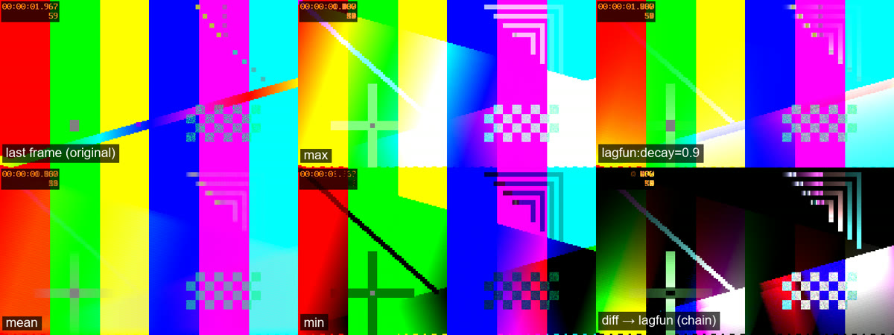

# shader-lab

A practice project for learning to write GPU shaders, with video as the raw material.

You write a small **HLSL compute filter** in a single file. shader-lab decodes a video on the graphics card, runs
your filter on every single frame, and gives you the result as one image (and optionally a video). The filter can
remember things between frames, and that is where it gets interesting: light trails, averages that remove noise,
motion that lights up, tails that fade.


*The same test clip through six filters. Top: the original, `max` (brightest value over the whole clip) and `lagfun`
(trails that fade). Bottom: `mean` (average), `min` (darkest value) and a chain `diff → lagfun` (only motion,
with a tail).*

**Why this is a good way to learn shaders:**

- **One filter = one file.** No C#, no graphics API, no windows. The core takes care of video, GPU resources and
  colour spaces; you only write what happens to one pixel.
- **Feedback in under a second.** With `--watch` the filter is compiled and run again every time you save.
- **Error messages that point at your line**, with the source line and a `^` under the error.
- **Time comes for free.** Because the filter sees hundreds of frames, you learn what most shader introductions
  skip: state, accumulation, precision and what happens over time.

Windows only (Direct3D 11). Technical specification: [`docs/shader-lab-spec.md`](docs/shader-lab-spec.md).

---

## Contents

1. [Getting started](#1-getting-started)
2. [How it works](#2-how-it-works)
3. [The workflow](#3-the-workflow)
4. [Learn shaders: from zero to your first filter](#4-learn-shaders-from-zero-to-your-first-filter)
5. [The filter contract (reference)](#5-the-filter-contract-reference)
6. [HLSL cheat sheet](#6-hlsl-cheat-sheet)
7. [Common mistakes and how to find them](#7-common-mistakes-and-how-to-find-them)
8. [Learning path: examples and exercises](#8-learning-path-examples-and-exercises)
9. [Chaining, video and preview](#9-chaining-video-and-preview)
10. [Testing](#10-testing)
11. [Command reference](#11-command-reference)
12. [Project structure](#12-project-structure)
13. [Working with an AI](#13-working-with-an-ai)
14. [Limitations and license](#14-limitations-and-license)

---

## 1. Getting started

### You need

| | Why |
|---|---|
| Windows 10/11 | Direct3D 11 and hardware video decoding (D3D11VA) |
| A graphics card that can decode H.264/HEVC | Almost any from the last ten years. Tested on NVIDIA |
| [.NET 9 SDK](https://dotnet.microsoft.com/download/dotnet/9.0) | Builds and runs the program |
| `ffmpeg` on PATH (optional) | Only for making test clips (`make-clips.ps1`) and for `--video-out`. The "full" build from [gyan.dev](https://www.gyan.dev/ffmpeg/builds/) has what is needed |

### First time

Open PowerShell in the repo folder:

```powershell
powershell -File get-ffmpeg.ps1      # fetches the FFmpeg 7.1 libraries into ffmpeg/ (once)
dotnet build
Set-Alias shaderlab (Resolve-Path .\bin\Debug\net9.0\shaderlab.exe)
shaderlab tests\clips\dot.mp4 -o out.png -f max
```

You should see something like:

```
GPU 0: <your graphics card>
Canvas: 256x144, stride=1, FrameCount=120
Chain: max
  dot.mp4: 256x144 h264, 120 frames
120 frames in 0.14 s (870 fps) -> out.png
```

`out.png` shows a white line: `dot.mp4` is a dot moving across a gray background, and `max` remembers the
brightest each pixel has been.

> **About the alias:** `Set-Alias` only applies in that PowerShell window. The rest of this README uses `shaderlab`.
> The alternative is `dotnet run -- <arguments>`, which also builds but is a bit slower to start. Filters never
> need a rebuild; only changes to the C# code do. The program finds `filters/` and `shaders/` by itself, even if you
> are in another folder.

See which filters exist:

```powershell
shaderlab --list-filters
```

More test clips (black, and a colour clip in 10-bit HEVC) are made with `powershell -File tests\make-clips.ps1`.
Only `dot.mp4` is in the repo.

---

## 2. How it works

```
 video.mp4 ──ffmpeg/D3D11VA──► decoded frame in VRAM (NV12 / P010)
                                   │
                                   ▼
                [core] decode.hlsl: YUV → linear RGB (RGBA32F)          ← fixed, you don't touch it
                                   │
                                   ▼
                filters/<yours>.hlsl  Accumulate()                       ← what you write
                   reads:  Input, StateIn0, FrameInfo, Params
                   writes: StateOut0 (remember for the next frame), Output (the image)
                                   │   … once per frame, through the whole clip
                                   ▼
                [core] (optional) Finalize() once at the end
                                   │
                                   ▼
                [core] encode.hlsl: linear → sRGB, 8 bits   →   out.png
```

Three things worth noting:

- **The frames never leave the GPU.** The decoder writes straight into video memory, the filter reads from there,
  and only the finished image is copied back. That is why it is fast: the bottleneck is the video decoder, not
  your shader.
- **Your filter only sees linear RGB in 32-bit floats.** YUV, gamma, 8/10 bits and video formats are handled
  before and after. Values above 1.0 are allowed along the way; they are only clipped when the image is written.
- **One shader "thread" per pixel.** The function `Accumulate` runs for every pixel, in parallel, for every frame.
  More on that in part 4.

---

## 3. The workflow

This is what a practice session looks like:

1. Start hot reload in a PowerShell window:
   ```powershell
   shaderlab tests\clips\dot.mp4 -o out.png -f lagfun --watch --max-frames 120
   ```
2. Open `out.png` in an image viewer that reloads the file automatically (VS Code, IrfanView, nomacs, …).
3. Open `filters\lagfun.hlsl` in the editor, change something, and save.
4. Within a second the terminal says `120 frames in 0.1 s -> out.png`, and the image is updated.
5. If you have an error, you see it at once, and the previous image stays:
   ```
   filters/lagfun.hlsl(15,52): error X3004: undeclared identifier 'decya'
           float4 v = max(Input[id.xy], StateIn0[id.xy] * decya);
                                                          ^^^^^
   Not run; out.png is untouched.
   ```
6. `Ctrl+C` exits.

Useful things along the way:

| Command | When |
|---|---|
| `-f lagfun:decay=0.8` | Try another parameter value without changing the file |
| `--max-frames 60` | A shorter run. `FrameCount` in the shader becomes 60 |
| `--exposure -2` / `--normalize` | The image is too bright/dark. `--normalize` makes the brightest value white |
| `shaderlab --dump-shader lagfun` | See exactly what was compiled (the core's preamble + your file), with line numbers |
| `tests\clips\color.mp4` | When you want to see colour and motion, not just a dot |
| Your own videos | Lightning, traffic at night, stars, water: that is where the filters get fun |

---

## 4. Learn shaders: from zero to your first filter

### 4.1 The mental model

A normal loop on the CPU would look like this:

```csharp
for (int y = 0; y < height; y++)
    for (int x = 0; x < width; x++)
        output[x, y] = input[x, y] * 2;
```

A **compute shader** is the *body* of the loop, and the GPU runs it for all pixels at once, in thousands of
parallel threads:

```hlsl
[numthreads(8, 8, 1)]
void Accumulate(uint3 id : SV_DispatchThreadID)
{
    if (any(id.xy >= Size)) return;
    Output[id.xy] = Input[id.xy] * 2;
}
```

- `id.xy` is the pixel this thread is responsible for (x, y). You write the code for **one** pixel.
- `[numthreads(8, 8, 1)]` means the threads are started in groups of 8×8. The core starts enough groups to cover
  the image, which is why there are often a few threads too many at the edges.
- `if (any(id.xy >= Size)) return;` sends the extra threads home. Forget it, and the threads at the edge work on
  pixels that do not exist. (D3D11 ignores writes outside the texture and returns 0 on reads, so the mistake
  usually only shows up as odd edges once you start reading neighbouring pixels.)
- The threads cannot talk to each other or know what the others are doing (apart from advanced `groupshared`,
  see exercise 10). Every pixel must be computable on its own.

### 4.2 Your first filter: a brighter image

Create `filters\brighten.hlsl`:

```hlsl
//! name: brighten
//! description: Makes the last frame brighter
//! state: 0
//! param: gain float 2 min=0 max=10

[numthreads(8, 8, 1)]
void Accumulate(uint3 id : SV_DispatchThreadID)
{
    if (any(id.xy >= Size)) return;   // threads outside the image do nothing

    float3 rgb = Input[id.xy].rgb;    // linear RGB for this pixel
    Output[id.xy] = float4(rgb * gain, 1);
}
```

Run it:

```powershell
shaderlab tests\clips\color.mp4 -o out.png -f brighten --watch
```

What you just used:

- **The `//!` lines** are the header. `name` is the name you use with `-f`. `state: 0` says the filter does not need
  to remember anything. `param` creates a variable `gain` that you can use directly in the code, and override with
  `-f brighten:gain=4`.
- **`Input`** is the frame, in linear RGB. **`Output`** is what becomes the image.
- Without state the result is just the last frame, processed. That is useful for learning the syntax, but it is
  state that makes this project interesting.

Try it: replace `rgb * gain` with `1 - rgb`, with `rgb.bgr` or with `rgb * float3(1, 0.5, 0.2)`, and see what happens.

### 4.3 Time: remembering between frames

A filter that remembers the brightest value each pixel has had:

```hlsl
//! name: brightest
//! description: Brightest value so far (my own max)

[numthreads(8, 8, 1)]
void Accumulate(uint3 id : SV_DispatchThreadID)
{
    if (any(id.xy >= Size)) return;

    float4 previous = StateIn0[id.xy];          // what we remembered from the previous frame
    float4 current  = Input[id.xy];             // this frame
    float4 result   = max(previous, current);

    StateOut0[id.xy] = result;                  // remember for the next frame
    Output[id.xy]    = result;                  // what becomes the image
}
```

This is the basic pattern of almost every filter: **read the previous state, compute, write the new state, write
the output.**

- `StateIn0` is what `StateOut0` was in the previous frame. The core swaps them after every frame ("ping-pong").
  Two separate textures are needed because thousands of threads read and write at the same time; reading and
  writing the same texture would cause chaos as soon as you look at neighbouring pixels.
- What is `StateIn0` before the first frame? That is decided by `//! init:`. The default is `0`. For `min` that
  would give a black image (the min of 0 and anything else is 0), which is why `filters\min.hlsl` uses
  `//! init: +inf`. `//! init: first` starts at the first frame, which `ema` needs.
- State is not just "the image so far". It can be a sum, a counter in `.a`, the previous frame (`diff`), or two
  things at once with `//! state: 2` (`StateIn1`/`StateOut1`).

### 4.4 Linear light: why the numbers are what they are

Pixel values in a video (and in a PNG) are *gamma-encoded*: 0.5 does not mean half as much light as 1.0, but about
a fifth. That is practical for storage, but wrong for arithmetic. shader-lab therefore converts everything to
**linear light** before your filter sees it, and back when the image is written.

Consequences you will notice:

- Averages, sums and blending become physically correct: `mean` looks like one long exposure, not a gray smear.
- The gray in the test clip is **0.216**, not 0.5. Middle gray on screen is about 0.2 in linear light.
- Some operations are made for the eye and belong in gamma space. `filters\invert.hlsl` converts to sRGB, inverts
  and converts back: try removing the conversion and see how wrong it gets.
- `SrgbToLinear`, `LinearToSrgb` and `Luma` live in `shaders\core\common.hlsli` and are always available.

### 4.5 Seeing values you cannot print

A shader cannot write to the console. If you want to know what a value is, **paint it**:

```hlsl
//! name: showtime
//! state: 0

[numthreads(8, 8, 1)]
void Accumulate(uint3 id : SV_DispatchThreadID)
{
    if (any(id.xy >= Size)) return;
    float progress = FrameIndex / (float)max(FrameCount, 1);   // 0 → 1 through the clip
    Output[id.xy] = float4(progress, Time / 4.0, 0, 1);         // red = progress, green = time
}
```

Run with different `--max-frames` values and watch the colour change. The technique works for anything: a weight,
a threshold, whether a condition is true (`Output[id.xy] = cond ? float4(1, 0, 0, 1) : Input[id.xy];`).

---

## 5. The filter contract (reference)

### Header

```hlsl
//! name: my-filter                        // required; used with -f
//! description: Short explanation         // shown in --list-filters
//! state: 1                               // 0, 1 (default) or 2 state textures
//! init: 0                                // 0 (default) | first | +inf | -inf
//! param: strength float 0.5 min=0 max=1  // 0 or more
```

- The header is the `//!` lines in the comment block at the top of the file. Normal `//` comments may sit in between.
- Parameter types: `float`, `float2`, `float3`, `float4`, `int`, `uint`. Vectors are written with commas:
  `//! param: colour float3 1,0.5,0` and `-f my-filter:colour=0,1,0`.
- `min`/`max` are optional and are checked when you give values with `-f`.

### What the core gives you (do not declare these yourself)

| Name | Type | Contents |
|---|---|---|
| `Input` | `Texture2D<float4>` | The current frame, linear RGB. In a chain: the previous step's `Output` |
| `Frame` | `Texture2D<float4>` | Always the original frame, wherever in the chain |
| `StateIn0`, `StateIn1` | `Texture2D<float4>` | State from the previous frame |
| `StateOut0`, `StateOut1` | `RWTexture2D<float4>` | New state |
| `Output` | `RWTexture2D<float4>` | What becomes the image |
| `FrameIndex` | `uint` | 0, 1, 2, … (after `--stride`). In `Finalize`: the number of frames |
| `FrameCount` | `uint` | Total number of frames if known, otherwise 0 |
| `Size` | `uint2` | The image width and height |
| `Time` | `float` | Seconds from the start of the current file |
| `Dt` | `float` | Seconds since the previous frame (0 for the first frame in each file) |
| `FileIndex` | `uint` | Which input file (with several) |
| your `param`s | as declared | From the header, overridden by `-f name:p=v` |
| `SrgbToLinear`, `LinearToSrgb`, `Luma` | functions | From `common.hlsli` |

### What you deliver

- **`Accumulate`** (required): runs once per frame. Read `Input` and `StateIn*`, write `StateOut*` and `Output`.
- **`Finalize`** (optional): runs once after the last frame, for example to divide a sum by the number of frames.
  It is detected automatically. See `filters\mean.hlsl`.

Both must have `[numthreads(8, 8, 1)]` and `uint3 id : SV_DispatchThreadID`, and should start with the bounds check.

---

## 6. HLSL cheat sheet

| What you want | HLSL |
|---|---|
| Vectors | `float`, `float2`, `float3`, `float4`; `uint2` etc. |
| Pick components ("swizzle") | `c.rgb`, `c.r`, `c.bgr`, `c.xxx` (the same value three times), `float4(c.rgb, 1)` |
| Arithmetic is per component | `a * b`, `a + 0.1`, `max(a, b)` on the whole vector |
| Blend | `lerp(a, b, t)` = a + (b − a)·t |
| Limit to 0..1 | `saturate(x)` |
| Soft threshold | `smoothstep(low, high, x)` goes smoothly from 0 to 1 between low and high |
| Hard threshold | `step(edge, x)` gives 0 or 1 |
| Brightness | `Luma(rgb)` (from common.hlsli) or `dot(rgb, float3(0.2126, 0.7152, 0.0722))` |
| Distance / length | `length(v)`, `distance(a, b)` |
| Choice | `cond ? a : b` (also works per component on vectors) |
| Read a neighbouring pixel | `Input[id.xy + int2(1, 0)]` (mind the edges) |
| Number literals | `1.0` is a float, `1` is an int. See trap 2 below |

More: [the HLSL reference at Microsoft](https://learn.microsoft.com/windows/win32/direct3dhlsl/dx-graphics-hlsl-reference)
(especially "Intrinsic Functions").

---

## 7. Common mistakes and how to find them

| Symptom | Likely cause |
|---|---|
| **Completely black image** | You do not write `Output`. Or the state starts at 0 where it should start at `first`/`+inf`. Or trap 2 |
| **Completely white image** | The values grow above 1 (sum, add blend, gain). Try `--normalize` or `--exposure -3` to see what is hiding there |
| **The image is just the last frame** | You do not read `StateIn0`, or do not write `StateOut0` |
| **Black dots or patches** | NaN or infinity: `pow` of a negative number, division by zero, `sqrt(-x)`. Use `max(x, 0)` or `abs` |
| **Warning about "implicit truncation"** | You pass a `float4` to a `float3` (or the other way round). Use `.rgb` or `float4(…, 1)` |
| **Odd edges** | You read neighbouring pixels outside the image. Clamp the coordinates with `clamp(p, 0, Size - 1)` |

**Trap 1 – forgotten bounds check.** Without `if (any(id.xy >= Size)) return;` the edge threads run code for pixels
that do not exist.

**Trap 2 – integer division.** `FrameIndex` and `FrameCount` are `uint`. `FrameIndex / FrameCount` is therefore
integer division and becomes **0** for every frame. Write `FrameIndex / (float)FrameCount`, or use a float literal:
`FrameCount / 120.0`.

**Trap 3 – `saturate` in state.** `saturate` clips to 0..1. Do that to a sum and you lose information. The core clips
by itself when the image is written; in state you should rarely clip.

**Your tools:** the error message points at the line; `--dump-shader <name>` shows the whole compiled source;
paint values as colours (4.5); `--max-frames 1` shows what happens on the first frame.

---

## 8. Learning path: examples and exercises

`filters\` has finished, commented examples. Read them in this order; the comments explain *why*, not just *what*.

| # | Filter | What you learn |
|---|---|---|
| 1 | `invert`, `grayscale` | Basic structure without state, linear vs sRGB, luma weights |
| 2 | `max`, `min` | State and ping-pong, why `init` matters |
| 3 | `lagfun` | Parameters, behaviour over time, how long a tail gets |
| 4 | `ema`, `mean` | Moving average vs a true average, `init: first`, `Finalize` |
| 5 | `blend` | Blend modes in linear light, values above 1, why `add` goes towards white |
| 6 | `diff` | The previous frame as state, a noise threshold with `smoothstep` |

Then it is your turn. These are **not** solved in the repo:

| # | Exercise | Hint |
|---|---|---|
| 7 | `trail-color`: trails that change colour over time | Start from `max`. Use `FrameIndex / (float)FrameCount` as the hue and compute hue → RGB. Only include pixels that are bright enough |
| 8 | `sigma-clip`: an average that ignores outliers (planes, birds, noise) | `//! state: 2`: a sum in one, a sum of squares in the other. Variance = E[x²] − E[x]². Reject values far from the mean |
| 9 | `bg-subtract`: show only what differs from the background | A slow `ema` is the background; compare `Input` with it. Try `-f bg-subtract -f lagfun` |
| 10 | `blur3x3` or `bilateral` | Read the neighbours `Input[id.xy + int2(dx, dy)]`. Mind the edges. Advanced: `groupshared` to read each pixel only once |

Make your own too. Some ideas: "slit-scan" (each column from a different time), a counter in `.a` that shows how
long a pixel has been bright, or a heat map of motion over the whole clip.

---

## 9. Chaining, video and preview

**Chaining.** Several `-f` make a chain where each step gets the previous step's `Output` as `Input`:

```powershell
shaderlab tests\clips\dot.mp4 -o out.png -f diff:gain=4 -f lagfun:decay=0.9
```

`diff` removes everything that stands still, and `lagfun` gives whatever moves a tail. Each step has its own state
and parameters, so the same filter can appear several times. If a later step needs the original image, it uses
`Frame`. Filter files need no changes to be used in a chain.

**Video.** `--video-out out.mp4` writes the result after every frame as a video, so you can see how the filter
behaves over time (needs `ffmpeg` on PATH):

```powershell
shaderlab tests\clips\color.mp4 -o out.png -f ema:alpha=0.05 --video-out out.mp4
```

`--normalize` does not apply to the video (it would flicker); use `--exposure`.

**Preview.** `--preview-every 300` overwrites `out.png` every 300th frame. With an image viewer that reloads, you
see long clips build up while they run.

---

## 10. Testing

Before you commit:

```powershell
powershell -File tests\run-tests.ps1
```

The script builds (warnings count as errors), checks that every filter compiles, runs every filter and a few
variants on `dot.mp4` and compares with the reference images in `tests\expected\`, and checks that error messages
point at the right line.

- **New filter:** the first run creates `tests\expected\<name>.png` and marks it "NEW". Look at the image, and
  commit it together with the filter.
- **Deliberately changed filter:** `powershell -File tests\run-tests.ps1 -UpdateExpected` rewrites every reference
  image. Look them over before you commit.
- **Differences:** the image from the run is in `tests\out\`. `shaderlab --compare a.png b.png` shows how large the
  difference is.

---

## 11. Command reference

```
shaderlab <video...> -o <out.png> -f <filter[:p=v,...]> [-f <filter> ...] [options]
```

| Option | Meaning |
|---|---|
| `-f, --filter <name[:p=v,…]>` | Filter with parameters. Several `-f` make a chain |
| `-o, --output <file.png>` | The image to write (required) |
| `--watch` | Hot reload: run again when a filter or `shaders\core` is saved. `Ctrl+C` exits |
| `--max-frames <n>` | Stop after n frames (across all input files) |
| `--stride <n>` | Use every n-th frame |
| `--exposure <stops>` | Brighter/darker before saving: linear × 2^stops |
| `--normalize` | Scale so the brightest value becomes white |
| `--preview-every <n>` | Write the image every n-th frame while running |
| `--video-out <file.mp4>` | Write the result per frame as video (needs `ffmpeg` on PATH) |
| `--list-filters` | Show the filters with parameters, and check that they compile |
| `--dump-shader <name>` | Show the source that gets compiled, with line numbers |
| `--compare <a.png> <b.png> [--tolerance n]` | Compare two images (exit 0 if the difference ≤ n/255, default 2) |
| `--filters-dir <folder>` | Use filters from another folder |
| `--gpu auto\|<n>`, `--list-gpus` | Pick the GPU (default: the one Windows considers most powerful) |
| `--ffmpeg-dir <folder>` | Another location for the FFmpeg libraries |

Several videos in the same run (`a.mp4 b.mp4`) are processed one after the other. The canvas gets the largest width
and height, and smaller videos are scaled up.

---

## 12. Project structure

```
filters/              ← your filters and the examples (one .hlsl per filter)
shaders/core/         ← the core: decode.hlsl, encode.hlsl, common.hlsli (rarely changed)
tests/
  clips/dot.mp4       ← the test clip (the others are made with make-clips.ps1)
  expected/           ← reference images
  bad/                ← deliberately broken filters that test the error messages
  run-tests.ps1, make-clips.ps1
docs/                 ← the spec and the image at the top of this file
Program.cs            ← the command line, runs and --watch
Gpu/                  ← D3D11: device, compilation, filter loading, pipeline, one step in the chain
Video/                ← FFmpeg: decoding on the GPU, colour spaces
Imaging/              ← PNG in/out, video out
Watch/                ← hot reload
```

---

## 13. Working with an AI

[`AGENTS.md`](AGENTS.md) contains rules for AI agents (Claude, Copilot etc.); `CLAUDE.md` points there. The most
important rule: **the AI should not write your filters** unless you ask it to. Let it instead:

- explain an error message (paste the output of `--dump-shader`, so it sees exactly what the compiler saw),
- give hints without solving the exercise ("how do I convert hue to RGB?"),
- review your filter ("why is mean too dark?", "why do I see banding?"),
- build core features and tests.

---

## 14. Limitations and license

**Limitations:** Windows and Direct3D 11 only. Only tested on NVIDIA. No CPU fallback: if the GPU cannot decode the
clip, the program says so. Lossless H.264 (`-qp 0`) is not supported by hardware decoders. The output is 8-bit sRGB.
HDR video is interpreted as SDR. Ideas for further work are in the spec §13.

**Third party:**

- [FFmpeg](https://ffmpeg.org) (LGPL), loaded dynamically. The build used is pinned in `get-ffmpeg.ps1`.
- [FFmpeg.AutoGen](https://github.com/Ruslan-B/FFmpeg.AutoGen) (MIT)
- [Vortice.Windows](https://github.com/amerkoleci/Vortice.Windows) (MIT)

The project is MIT licensed, see [LICENSE](LICENSE).
